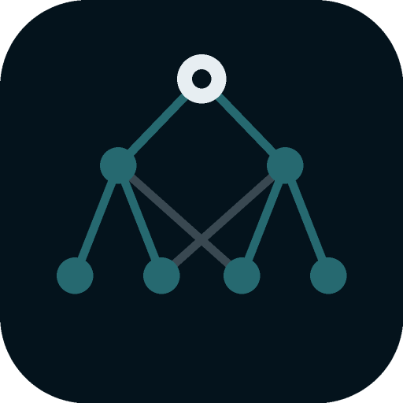

<p align="center">
  
</p>

<h1 align="center">memtree</h1>

<p align="center">
  <b>Persistent memory for coding agents — that you can see, search and edit.</b>
</p>

<p align="center">
  <a href="https://github.com/aitakemyjob/memtree/actions/workflows/ci.yml"></a>
  <a href="https://github.com/aitakemyjob/memtree/releases/latest"></a>
  
  <a href="LICENSE"></a>
</p>

memtree is a local service that gives Claude Code, Codex, Cursor, VS Code and
any other [MCP](https://modelcontextprotocol.io) client a memory that outlives
the conversation. Agents **recall** decisions, lessons and preferences from
earlier work, **save** new ones, and every memory is placed on a **category
lattice** and fades with time the way human memory does. Hooks capture and
inject memory automatically; a desktop (or browser) UI lets you inspect and
change everything the agents remember.

It extracts the memory and lattice from the Cortex agent into a standalone,
open-source tool. **memtree runs no model of its own:** the agent summarises
and classifies, memtree stores, ranks, forgets gradually and shows its work.

## Features

| | |
|---|---|
| **Recall by wording and by association** | Full-text search (BM25, stemming) merged with spreading activation over the category lattice, so a note about "blue-green deploys" surfaces for "how do releases work" even with no shared words. |
| **Time-based memory** | ACT-R activation: memories you rely on stay sharp, unused ones cool. Old related notes become candidates for distilling into one semantic gist; originals are superseded, never deleted. |
| **The lattice** | A DAG of slash-path categories agents grow as they work. Probe any prompt in the UI to see which categories light up and what surfaces. |
| **Hooks** | `memtree install claude-code` (also `codex`, `cursor`, `vscode`): a session-start anchor, quiet per-prompt recall, and transcript capture that agents later summarise. Hooks fail open and never block the agent. |
| **MCP server** | 18 tools: `recall`, `memory_save`, `lattice_browse`, `captures_pending`, `memory_compress`… See [docs/MCP.md](docs/MCP.md). |
| **A UI to inspect and edit** | Memories (edit, pin, supersede, archive, "why this score"), an interactive lattice graph, a timeline heatmap, the capture queue, consolidation, and a live activity feed of every agent and hook call. |
| **Project scoping** | Memories belong to a repo (or are global). Recall prefers the current project and never leaks another one. |
| **Yours** | Local SQLite file, loopback-only server, no network calls, MIT licensed. |

## Install

memtree is not published as a release yet, so install it from source. It
takes a few minutes.

### 1. Prerequisites

| | Needed for | Check |
|---|---|---|
| **Go 1.26+** | everything | `go version` |
| **Node 22+** and npm | building the UI | `node --version` |
| **git** | cloning | `git --version` |
| WebKitGTK 4.1 + GTK 3 headers (Linux only) | the desktop window only; skip for the headless build | `pkg-config --modversion webkit2gtk-4.1` |

On Debian/Ubuntu the desktop headers are `sudo apt install libgtk-3-dev libwebkit2gtk-4.1-dev`
(Fedora: `gtk3-devel webkit2gtk4.1-devel`). macOS needs the Xcode command-line
tools; Windows needs WebView2 (preinstalled on Windows 11).

### 2. Build

```sh
git clone https://github.com/aitakemyjob/memtree.git
cd memtree
make deps        # frontend packages (npm ci)
make headless    # builds the UI, then embeds it → build/bin/memtree-headless
```

The UI is embedded into the binary **at build time**, so always build the
frontend first (`make headless` and `make build` do this for you). A binary
built without it still runs MCP and hooks, and `memtree serve` shows a page
saying the UI is missing.

For the desktop app instead (needs the WebKitGTK headers on Linux):

```sh
make build       # → build/bin/memtree (macOS: build/bin/memtree.app)
```

### 3. Put it on your PATH

Hooks and the MCP config store the binary's **absolute path**, so install it
somewhere permanent *before* running `memtree install`:

```sh
mkdir -p ~/.local/bin
cp build/bin/memtree-headless ~/.local/bin/memtree   # or build/bin/memtree for the desktop app
memtree version
```

(Make sure `~/.local/bin` is on your `PATH`.) If you move or rename the binary
later, run `memtree install <harness>` again to update the paths.

The headless build is all you need: hooks and MCP use it, and `memtree serve`
opens the same UI in your browser. Use the desktop build if you want a window.

### 4. Connect your agent

```sh
memtree install claude-code -dry-run   # shows exactly what it will change
memtree install claude-code            # user scope; add -project . for one repo
```

Then restart the agent. Other harnesses: `codex` (afterwards run `/hooks` in
Codex once to trust the hooks), `cursor`, `vscode -project .` (VS Code is per
workspace). `memtree install <harness> -uninstall` removes only memtree's
entries; the first edit of each file leaves a `.memtree.bak` backup. Details in
[docs/HOOKS.md](docs/HOOKS.md).

Nothing needs to stay running. The harness starts `memtree mcp` itself, and it
works against the database directly when the app is closed. Run `memtree serve`
(or the desktop app) when you want to see or edit memory; while it runs, the
Activity view shows every hook and tool call live.

### Where things live

| | Linux | macOS | Windows |
|---|---|---|---|
| Memory database | `~/.local/share/memtree/memtree.db` | `~/Library/Application Support/memtree/memtree.db` | `%LOCALAPPDATA%\memtree\memtree.db` |
| Settings and `hook-errors.log` | `~/.config/memtree/` | `~/Library/Application Support/memtree/` | `%AppData%\memtree\` |

Override with `MEMTREE_DB` and `MEMTREE_CONFIG`. The default port is 47475
(change it in Settings or with `-port`).

### Updating

```sh
git pull && make deps headless && cp build/bin/memtree-headless ~/.local/bin/memtree
```

### Uninstalling

```sh
memtree install claude-code -uninstall   # repeat per harness you installed
rm ~/.local/bin/memtree
rm -r ~/.local/share/memtree ~/.config/memtree   # deletes all memories and settings
```

### Prebuilt releases (once published)

```sh
curl -fsSL https://raw.githubusercontent.com/aitakemyjob/memtree/main/scripts/install.sh | sh                 # macOS / Linux
irm https://raw.githubusercontent.com/aitakemyjob/memtree/main/scripts/install.ps1 | iex                      # Windows
```

## Quick start

1. Install and connect your agent as above (`memtree install claude-code`).
2. Launch `memtree serve` (browser) or `memtree` (desktop build).
3. Work as usual. Open the **Activity** view to watch hooks and tool calls
   arrive, **Memories** to see what is remembered, **Lattice** to see how it is
   organised.

Other MCP clients: point them at `memtree mcp` (stdio), or at
`http://127.0.0.1:47475/mcp` (streamable HTTP) while the app is running. The
**Connect** dialog in the UI has a snippet for each client.

## Command line

```
memtree                         launch the desktop app
memtree serve                   headless; open the same UI in your browser
memtree mcp                     stdio MCP bridge to the running app (standalone if it is closed)
memtree install <harness>       wire hooks + MCP into claude-code | codex | cursor | vscode
memtree hook <harness> [event]  run a hook (called by the harness)
memtree recall <query>          search memory from the terminal
memtree version
  -port N     loopback port (default 47475)      -project DIR   scope to a project
  -dry-run    (install) show changes only         -uninstall     (install) remove memtree
```

## How an agent uses it

```text
session starts → hook injects: "Last session: split the api package. Open loop: write
                 migration notes. 2 sessions awaiting a summary."
user: "why did we pick sqlite?"  → hook injects the storage decision (quiet if nothing relates)
agent: recall("storage decision")      → ranked memories with ids, ages, why they matched
agent: memory_save(summary, lattice_paths=["project/decisions/storage"], importance=1.5)
agent: memory_supersede(old, new)      → the old note stops appearing, but is kept
```

Details: [docs/ARCHITECTURE.md](docs/ARCHITECTURE.md), [docs/HOOKS.md](docs/HOOKS.md).

## Safety model

- **Local only.** The server binds `127.0.0.1`, rejects non-loopback `Host`
  headers (DNS rebinding), and requires a custom header plus same-origin for
  the UI API. No network calls; no model.
- **Nothing is silently destroyed.** Compression supersedes, agents archive,
  only a human action in the UI deletes.
- **You can switch agents to read-only** (Settings → Agent writes) and watch
  every call in the Activity view.
- **Recalled memory is framed as possibly stale**, dated facts, never
  instructions, and capped in size.
- **Hooks fail open.** A memory problem can never block your agent.
- **Captured conversations are stored unencrypted** in the local database,
  including anything you type, so turn off Capture hooks for sensitive work.
  See [SECURITY.md](SECURITY.md).

## Building from source

You need **Go 1.26+** and **Node 22+**. The build scripts install the Wails CLI
if it's missing.

| Platform | Prerequisites | Build |
|---|---|---|
| Linux | `sudo apt install libgtk-3-dev libwebkit2gtk-4.1-dev` (Fedora: `gtk3-devel webkit2gtk4.1-devel`); optional [`nfpm`](https://nfpm.goreleaser.com) for .deb/.rpm | `scripts/build.sh --package` |
| macOS | Xcode command-line tools (`xcode-select --install`) | `scripts/build.sh --package` |
| Windows | [WebView2](https://developer.microsoft.com/microsoft-edge/webview2/) (preinstalled on Windows 11); optional NSIS for the installer | `scripts\build.ps1 -Package` |

```sh
make headless && ./build/bin/memtree-headless serve   # no webview needed
scripts/build.sh --headless --package                 # no-webview binaries for every OS/arch
make test                                             # Go (race) + frontend tests
make dev                                              # hot-reload development
make help                                             # everything else
```

Hooks run the same binary (`memtree hook …`), so installing the headless
build keeps them light.

## Releasing

From a clean `main`: `make release VERSION=v0.2.0`. That runs the tests, then
tags and pushes; the [Release workflow](.github/workflows/release.yml) builds
every platform with the scripts above, writes `checksums.txt` and publishes a
GitHub release (`v1.0.0-rc.1`-style tags become pre-releases). To sign and
notarize macOS builds add the `MACOS_CODESIGN_IDENTITY`, `APPLE_ID`,
`APPLE_TEAM_ID` and `APPLE_APP_PASSWORD` repository secrets.

## Contributing

Issues and pull requests are welcome. Please read [CONTRIBUTING.md](CONTRIBUTING.md)
and the [Code of Conduct](CODE_OF_CONDUCT.md) first.

## Documentation

- [Architecture](docs/ARCHITECTURE.md): the model, scoring, lattice, differences from Cortex
- [Hooks](docs/HOOKS.md): per-harness support and what gets injected
- [MCP tools](docs/MCP.md): the tool reference

## License

[MIT](LICENSE)
